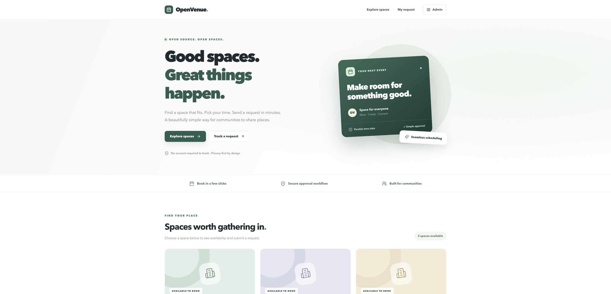

# OpenVenue

**Self-hosted venue booking and approval for schools, community centers and small organizations.**

[中文说明](README.zh-CN.md) · [Install](docs/installation.md) · [Upgrade](docs/container-verification.md#已有-v021-部署) · [Report a bug](https://github.com/gbhysss/open-venue-booking/issues/new/choose) · [Security](SECURITY.md)



> **v0.2.2 is a preview release.** Linux Docker Compose deployment, PostgreSQL integration, HTTP regressions and database restart recovery passed in [GitHub CI](https://github.com/gbhysss/open-venue-booking/actions/runs/41266819211). A public hosted demo is not provided; the screenshots use fictional data. See [verification scope](QUALITY_STATUS.md).

## What you can do

| For applicants | For administrators |
| --- | --- |
| Browse venues and confirmed occupied slots | Add venues and pause new requests |
| Request a future date and time without an account | Review requests with server-side filtering and pagination |
| Save a private status link | Approve or reject requests and leave a decision note |
| Use the same web app on phone or desktop | Prevent overlapping approvals at the PostgreSQL level |

OpenVenue runs as one independent organization per deployment. It uses Next.js, React, TypeScript, PostgreSQL, Drizzle, Better Auth and Zod. The current web interface is English; documentation is available in English and Chinese.

## Start with Docker

Install Docker with Compose v2 (Docker Desktop on macOS), Git and OpenSSL. In a fresh directory:

```bash
git clone https://github.com/gbhysss/open-venue-booking.git
cd open-venue-booking
bash scripts/setup-docker.sh
```

The script generates unique local database/authentication secrets, initializes the schema, asks you to choose an administrator email and a password of at least 12 characters, and optionally adds three fictional venues. It waits for database and application readiness.

Open **http://localhost:3000**; sign in at **http://localhost:3000/login**. There is no shared default password and no public administrator signup. Keep the private link shown after each booking submission.

The initial download/build needs Internet access. An existing `.env` is preserved; follow the [manual installation and upgrade instructions](docs/installation.md) for an existing deployment.

```bash
docker compose ps
curl --fail http://localhost:3000/api/health
docker compose down  # stops services and retains the database volume
```

See [the demo walkthrough](docs/container-verification.md), [screenshots](docs/screenshots/README.md) and [v0.2.2 release notes](docs/releases/v0.2.2.md).

## Local development

Requirements: a maintained Node.js 22 version at or above 22.16, npm, PostgreSQL 17+, and your own empty database.

```bash
cp .env.example .env
# Configure DATABASE_URL, BETTER_AUTH_SECRET, BETTER_AUTH_URL and APP_URL.
npm ci
npm run db:migrate
# Set ADMIN_EMAIL and ADMIN_PASSWORD temporarily; see docs/installation.md.
npm run admin:create
npm run dev
```

Run `npm run test:static`, `npm run typecheck`, `npm test` and `npm run build`. PostgreSQL tests require an explicit disposable `TEST_DATABASE_URL` ending in `_test`; otherwise those tests are skipped. Local HTTP tests also require the explicit `TEST_APP_URL` and fictional test admin credentials. [CI](.github/workflows/ci.yml) shows a complete test environment.

## Deployment and privacy

- The default Compose configuration exposes the app only on `127.0.0.1:3000` and does not publish a database port. Use HTTPS and a configured reverse proxy for a public site; `APP_URL` must exactly match its browser origin.
- Application writes validate JSON size and privileged request origins. Booking inserts atomically enforce 5 accepted submissions per email per 24 hours and a deployment-wide per-minute ceiling (`BOOKING_MAX_PER_MINUTE`, default 60). Add proxy-level limits for request floods.
- Tracking links are bearer secrets passed in a URL fragment and POST body. Anyone with a full link can view its status and administrator note. Keep personal information out of those notes.
- Applicant email ownership is not verified. Define retention/deletion, privacy notices, backups and access policies before collecting personal information.
- Never upload a real `.env`, database dump, credentials or applicant records. Do not use `docker compose down -v` on a database you need to retain.

This preview has not received an independent penetration test. Email delivery, QR check-in, attachments, payment, multilingual UI and multi-tenant isolation are not included.

## Contribute

Bug reports, documentation improvements, accessibility fixes and translations are welcome. Use the [issue templates](https://github.com/gbhysss/open-venue-booking/issues/new/choose) and read [CONTRIBUTING.md](CONTRIBUTING.md). Report vulnerabilities privately using [SECURITY.md](SECURITY.md).

Next priorities: installation feedback from independent deployments, accessibility/localization, notifications, and a broader audit trail UI. Usage and adoption have not yet been established.

## License

[MIT](LICENSE) for this repository's application code and documentation, except where otherwise identified. Dependencies retain their own licenses; see [THIRD_PARTY_NOTICES.md](THIRD_PARTY_NOTICES.md).
