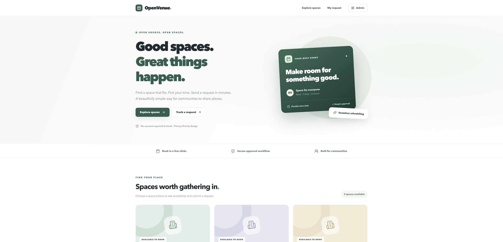

# OpenVenue 开源场馆预约系统

**面向学校、社区活动中心及小型组织的自托管场馆预约与审批系统。**

[English](README.md) · [安装说明](docs/installation.md) · [容器验收与升级](docs/container-verification.md) · [问题反馈](https://github.com/gbhysss/open-venue-booking/issues/new/choose) · [安全报告](SECURITY.md)



> **v0.2.2 为预览版。** 已通过 Linux Docker Compose、PostgreSQL、HTTP 回归与数据库重启恢复验收：[查看 CI](https://github.com/gbhysss/open-venue-booking/actions/runs/41266819211)。未提供公网托管演示，截图均使用虚构数据。完整验证范围见 [QUALITY_STATUS.md](QUALITY_STATUS.md)。

## 功能

- 访客无需账号即可浏览场馆、查看已批准的占用时段、提交未来预约。
- 提交后生成私密查询链接，用于查看审批状态；请自行保存。
- 管理员独立登录，新增或暂停场馆，筛选、分页查看预约并批准或驳回。
- PostgreSQL 排他约束防止同一场馆出现重叠的已批准预约。
- 配置同源校验、请求体限制、原子提交配额和容器健康检查。
- 每个组织独立部署一套应用与数据库。当前网页界面为英文，文档提供中英文版本。

## Docker 快速启动

先安装并启动带 Compose v2 的 Docker（Mac 使用 Docker Desktop），并准备 Git、OpenSSL。在全新目录执行：

```bash
git clone https://github.com/gbhysss/open-venue-booking.git
cd open-venue-booking
bash scripts/setup-docker.sh
```

脚本会生成独立随机密钥、初始化数据库，让你设置管理员邮箱和至少 12 位密码，并询问是否添加三个虚构场馆。它会等待数据库和应用真正就绪。

- 前台：**http://localhost:3000**
- 后台登录：**http://localhost:3000/login**
- 没有统一默认密码，线上管理员注册入口关闭。

首次运行需要联网下载镜像和依赖。已有 `.env` 时脚本不会覆盖；已有部署请按 [升级说明](docs/container-verification.md#已有-v021-部署) 操作。

```bash
docker compose ps
curl --fail http://localhost:3000/api/health
docker compose down  # 停止服务并保留数据库卷
```

更多操作见 [安装说明](docs/installation.md)、[本机演示步骤](docs/container-verification.md)、[截图说明](docs/screenshots/README.md)、[发布说明](docs/releases/v0.2.2.md)。

## 本地开发

需要受维护的 Node.js 22（至少 22.16）、npm、PostgreSQL 17+ 和独立空数据库。

```bash
cp .env.example .env
# 编辑 DATABASE_URL、BETTER_AUTH_SECRET、BETTER_AUTH_URL、APP_URL。
npm ci
npm run db:migrate
# 临时设置 ADMIN_EMAIL、ADMIN_PASSWORD，具体命令见安装说明。
npm run admin:create
npm run dev
```

检查命令：`npm run test:static`、`npm run typecheck`、`npm test`、`npm run build`。数据库测试须显式设置以 `_test` 结尾的可丢弃测试库；未设置时会跳过。API 回归还需要本机测试网站及虚构管理员，完整示例见 [CI 配置](.github/workflows/ci.yml)。

## 部署边界

- 默认只将应用绑定到本机端口，不暴露数据库；公网访问应配置 HTTPS、反向代理和限流，`APP_URL` 必须匹配实际访问来源。
- 默认每邮箱 24 小时最多接受 5 次提交，全站每分钟最多 60 次，可用 `BOOKING_MAX_PER_MINUTE` 调整。匿名邮箱未验证所有权，这些措施不能代替代理层抗滥用控制。
- 私密链接的持有者能查看审批状态和管理员备注，不要在备注中写入不应公开的个人信息。
- 收集真实信息前，请建立隐私告知、保留/删除规则、备份恢复和管理员权限流程。
- 请勿提交真实 `.env`、数据库导出、密钥或预约记录；保留数据的部署不要使用 `docker compose down -v`。

本预览版未接受独立渗透测试；暂不包含邮件、二维码签到、附件、支付、多语言界面和多租户隔离。项目尚无已核实的外部用户或采用规模。

## 参与和许可证

欢迎通过 [反馈模板](https://github.com/gbhysss/open-venue-booking/issues/new/choose) 报告安装问题或建议。贡献前阅读 [CONTRIBUTING.md](CONTRIBUTING.md)，漏洞请走 [私密安全报告](SECURITY.md)。

本仓库应用代码及文档采用 [MIT](LICENSE)，另有说明的内容除外。依赖保留各自许可证，见 [THIRD_PARTY_NOTICES.md](THIRD_PARTY_NOTICES.md)。
